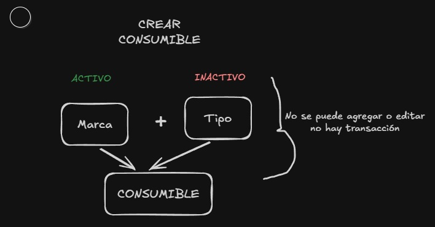
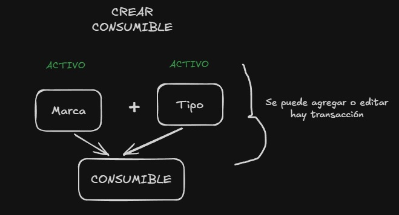

# SISTEMA CONSUMIBLES  

El Sistema de Consumibles CEAS es una aplicación web desarrollada para apoyar la gestión y el control del inventario de equipos informáticos y sus consumibles.

Su objetivo es facilitar los procesos relacionados con el registro de equipos, la asociación de consumibles, el control de entradas y salidas y la administración de evidencias y registros, contribuyendo a mejorar la organización y la trazabilidad de las operaciones.

## P

## CARACTERISTICAS DEL PROYECTO

- Creación de catalógos para gestión de inventarios de equipos y consumibles(MARCAS, TIPOS, AREAS DE ASIGNACIÓN, MODELOS, DIRECCIONES)
- Modificación, edición e inhihabilitar católogos
- Control de inventario de equipos(edicion, ingreso, clasificación, busqueda...)
- Control e inventario de consumibles (edicion, clasificacíon, busquedad...)
- Asociaciación de consumibles y equipos
- Registro y trazabilidad  de entradas y salidas de cosumibles de acuerdo a la asociacion de consumibles y equipos.
- Generación de PDF y exportación de datos a excel (catalógos, inventarios...)
- Gestión de sistema en base roles, creación, edición e inhabilitación de usuarios
- Protección de rutas en base a roles
- Uso de sesiones en DB
- Encriptación de constraseñas
- Estilo de importación ES6
- 1 Administrador 

## SEGURIDAD

- Sanitización de los datos(XSS)
- Middelware de autenticación
- Validación de datos (frontend y backend)
- Caducidad de sesiones (3 horas, puede cambiar el tiempo en index.js)
- Race condition limitado
- Renderizado de variables y datos correctos del motor de plantilla (SSTI)
- Usuario de base de datos con permisos limitados

## TECNOLOGIAS USUADAS

1. JAVASCRIPT, CSS Y HTML
2. RUNTIME: **NODE.JS**
3. MOTOR DE PLANTILLAS: **PUG**
4. BASE DE DATOS: **MYSQL**
5. VERSIONADO DE CODIGO: **GIT Y GITHUB**

## VERSIANDO DE ENTORNO DE EJECUCCION

1. MYSQL SERVER: **V.8.0**
2. MYSQL: **v. 15.1 o mayor**
3. NODEJS: **v. 22.2**

## INSTALACION

una vez realizado el clone del repostorio e instalado el entorno de ejecucion, podra descargar las librerias necesarias del **package.json**

> npm install 

o bien si el **packfage-lock** estan sicronizados puede utilizar, devolver a npm en caso de error de instalacion de dependencias

> npm install ci

<small> nota: dependencias obsoletas en este proyecto que fueron usadas son :connect-flash, timeago.js y solo para desarrllo o modo prueba nodemon</small>

## CONFIGURACION DE USUARIO DE BASE DE DATOS

En el archivo **dbData.js** existe las crendenciales para la autenticación del usuario creado en MYSQL, tal cual los nombres o bien cambiar las credenciales de acuerdo al administrador de sistema, tanto en usuario como en nombre de base de datos.

<small>**nota: el usuario creado debe contener los permisos basicos de consulta y cambios, no para alterar cambio total en la db, dejarlo para root**</small>

## IMPORTACION DE BASE DE DATOS

El equipo de desarrollo debera proporcionar un .SQL para importar al server, debera limpiar los datos de prueba o producción **(siempre y cuando exista backup realizado)** y dejar en la tabla de usuarios el administrador para iniciar el sistema

<small>**nota: en caso de no tipear los catalógos anteriores segun el año, dejar los datos necesarios para la funcionalidad del sistema**</small>

## INCIO DE APLICACION Y SERVIDOR

Luego de importa la base de datos, crear y modificar las crendenciales del usuario de la base de datos para el pool connection, instalar y configurar el entorno de ejecucción se puede inicializar el proyecto con el comando:

>
> npm run start
>
En caso de que se quiera correr en modo desarrollador ejecutar el comando

>
> npm run dev
>

El logger permite ver el body e información del **request** y **response** del servidor, no debe estar a la vista de cualquier personal, solo aquellos autorizados en el desarrollo y mantenimiento del sistema

## MODELO DE NEGOCIO, FLUJO DEL SISTEMA

### ROLES DEL SISTEMA

El sistema trabaja con 3 roles, cada una cuenta con sus propios routers, prefijos y funciones las cuales son las siguientes:

1. **Administrador:** Se encarga de controlar todo el catalógo de **equipos y consumibles** (marcas, tipos, modelos...), asi como la creación de usuarios nuevos que tendran roles diferentes, solo habrá un administrador. solo el o los administradores de sistema tendran acceso al usuario

    - responsabilidades: registrar y actualizar catalógos, inventario de equipos, clasificar equipos, clasificar consumibles, relacionar consumibles con equipos, mantener información actualizada de equipos y consumibles, gestionar y limitar acceso a usuarios

2. **Capturista:** Se encarga de registrar y controlar las entradas y salidas de los consumibles (registrados por el administrador), asi como la visualizacion del stock en tiempo real de los consumibles, es decir, mover los consumibles para las necesidades de las areas. asi como cancelar entradas y salidas no efectuadas sobre el inventario de consumibles, ver estadisticas

    - responsabilidades: verificar las entradas de los consumibles, asi como sus correctas salidas de acuerdo a la relación de los consumibles con los equipos, asi como la busqueda y alerta de los consumibles criticos de las necesidades de las areas

3. **Cliente**: Se encarga de visualizar el stock en tiempo real nada mas, cuyo propositó es dar acceso a los usuarios de las areas para visualizar el consumible que se requiere de algun equipo previamente capturado del inventario de equipos.

### VALIDACIONES DE FLUJO DE SISTEMA

#### ACTIVO O INACTIVO?
Borrar registros es una tarea facil de hacer en cuanto acción, mas no a la hora de planificar que borrar, todo sistema que conlleve gestión y control normalmente se realiza switches que permitan activar y desactivar funcionalidades, usuarios, accesos... y datos, consumibles ceas no es la excepcion, para que se pueda agregar y modificar un dato depenedera no solo de los catalógos que los conforman (jerarquía), si no que estos esten activos para formar un dato o  el dato en si.

**Dentro de las notificaciones apareceran los errores de validaciones si un item esta inactivo o el item este activo**

INACTIVO

ACTIVO

Estas validaciones permiten que cuando se requiera que un item formado o el item ya no se utilice, este quede inactivo evitando que se siga agregando o modificando registros, por otro lado, representa la manera de permitir una buena integridad y trazabilidad de los datos.

